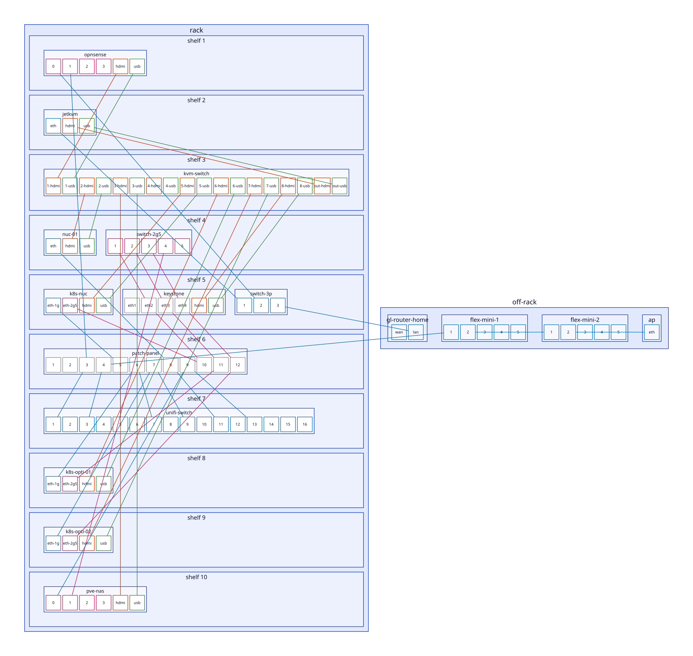
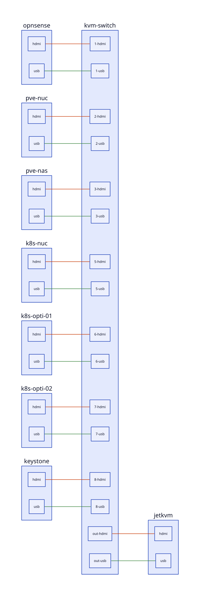

<!-- GENERATED by just docs; do not edit -->
# Devices

> **Target state**: this page describes the home network after the OPNsense cut-over, which hasn't happened yet.

From [`ansible/group_vars/all/devices.yaml`](../ansible/group_vars/all/devices.yaml), with the Cables from [`network.yaml`](../ansible/group_vars/all/network.yaml). Rack is the shelf counted from the top; Devices without one are off-rack. Host means it's in the inventory. Networks and addresses are in [network.md](network.md).

| Device | Kind | Model | Rack | Host | Specs |
|---|---|---|---|---|---|
| [opnsense](#opnsense) | router | Topton N5105 | 1 |  | N5105 4c/4t, 16 GB, 256 GB NVMe |
| [jetkvm](#jetkvm) | kvm | JetKVM | 2 |  |  |
| [kvm-switch](#kvm-switch) | kvm-switch | Steetek 8 Port HDMI KVM Switch | 3 |  |  |
| [pve-nuc](#pve-nuc) | server | Intel NUC 8 | 4 |  | i5-8259U 4c/8t, 16 GB, 1 TB NVMe |
| [switch-2g5](#switch-2g5) | switch | Horaco 5 Port 2.5GbE | 4 |  |  |
| [k8s-nuc](#k8s-nuc) | server | Intel NUC 12 Pro | 5 |  | i7-1260P 12c/16t, 64 GB, 512 GB SSD, 512 GB NVMe |
| [keystone](#keystone) | patch-panel |  | 5 |  |  |
| [switch-3p](#switch-3p) | switch | N/A | 5 |  |  |
| [patch-panel](#patch-panel) | patch-panel |  | 6 |  |  |
| [unifi-switch](#unifi-switch) | switch | Ubiquiti USW Lite 16 PoE | 7 |  |  |
| [k8s-opti-01](#k8s-opti-01) | server | Dell OptiPlex 7080 (TODO(you): or the 7060) | 8 |  | i5-10500T 6c/12t, 32 GB, 512 GB SSD, 512 GB NVMe |
| [k8s-opti-02](#k8s-opti-02) | server | Dell OptiPlex 7060 (TODO(you): or the 7080) | 9 |  | i5-8500T 6c/6t, 32 GB, 512 GB SSD, 500 GB NVMe |
| [pve-nas](#pve-nas) | server | Topton N5105 NAS | 10 |  | N5105 4c/4t, 16 GB, 256 GB SSD, 2x 1 TB NVMe, 2x 14 TB HDD, 2x 6 TB HDD |
| [gl-router-home](#gl-router-home) | router | GL.iNet (TODO(you): model) |  |  |  |
| [flex-mini-1](#flex-mini-1) | switch | Ubiquiti USW Flex Mini |  |  |  |
| [flex-mini-2](#flex-mini-2) | switch | Ubiquiti USW Flex Mini |  |  |  |
| [ap](#ap) | ap | Ubiquiti U6 Lite |  |  |  |

## opnsense

| Port | Kind | Speed | MAC | Peer |
|---|---|---|---|---|
| 0 | ethernet | 2.5G |  | switch-3p:2 |
| 1 | ethernet | 2.5G |  | unifi-switch:1 via patch-panel:3 |
| 2 | ethernet | 2.5G |  |  |
| 3 | ethernet | 2.5G |  |  |
| hdmi | hdmi |  |  | kvm-switch:1-hdmi |
| usb | usb |  |  | kvm-switch:1-usb |

## jetkvm

| Port | Kind | Speed | MAC | Peer |
|---|---|---|---|---|
| eth | ethernet | 1G | 30:52:53:0e:af:e4 | switch-3p:1 |
| hdmi | hdmi |  |  | kvm-switch:out-hdmi |
| usb | usb |  |  | kvm-switch:out-usb |

## kvm-switch

| Port | Kind | Speed | MAC | Peer |
|---|---|---|---|---|
| 1-hdmi | hdmi |  |  | opnsense:hdmi |
| 1-usb | usb |  |  | opnsense:usb |
| 2-hdmi | hdmi |  |  | pve-nuc:hdmi |
| 2-usb | usb |  |  | pve-nuc:usb |
| 3-hdmi | hdmi |  |  | pve-nas:hdmi |
| 3-usb | usb |  |  | pve-nas:usb |
| 4-hdmi | hdmi |  |  |  |
| 4-usb | usb |  |  |  |
| 5-hdmi | hdmi |  |  | k8s-nuc:hdmi |
| 5-usb | usb |  |  | k8s-nuc:usb |
| 6-hdmi | hdmi |  |  | k8s-opti-01:hdmi |
| 6-usb | usb |  |  | k8s-opti-01:usb |
| 7-hdmi | hdmi |  |  | k8s-opti-02:hdmi |
| 7-usb | usb |  |  | k8s-opti-02:usb |
| 8-hdmi | hdmi |  |  | keystone:hdmi/back |
| 8-usb | usb |  |  | keystone:usb/back |
| out-hdmi | hdmi |  |  | jetkvm:hdmi |
| out-usb | usb |  |  | jetkvm:usb |

## pve-nuc

| Port | Kind | Speed | MAC | Peer |
|---|---|---|---|---|
| eth | ethernet | 1G |  | unifi-switch:11 via patch-panel:8 |
| hdmi | hdmi |  |  | kvm-switch:2-hdmi |
| usb | usb |  |  | kvm-switch:2-usb |

## switch-2g5

| Port | Kind | Speed | MAC | Peer |
|---|---|---|---|---|
| 1 | ethernet | 2.5G |  | k8s-nuc:eth-2g5 via keystone:eth2, patch-panel:10 |
| 2 | ethernet | 2.5G |  | k8s-opti-01:eth-2g5 via keystone:eth3, patch-panel:11 |
| 3 | ethernet | 2.5G |  | k8s-opti-02:eth-2g5 via keystone:eth4, patch-panel:12 |
| 4 | ethernet | 2.5G |  | pve-nas:1 |
| 5 | ethernet | 2.5G |  |  |

## k8s-nuc

| Port | Kind | Speed | MAC | Peer |
|---|---|---|---|---|
| eth-1g | ethernet | 1G |  | unifi-switch:5 via patch-panel:5 |
| eth-2g5 | ethernet | 2.5G |  | switch-2g5:1 via patch-panel:10, keystone:eth2 |
| hdmi | hdmi |  |  | kvm-switch:5-hdmi |
| usb | usb |  |  | kvm-switch:5-usb |

## keystone

| Port | Kind | Speed | MAC | Peer |
|---|---|---|---|---|
| eth1/front | ethernet |  |  |  |
| eth1/back | ethernet |  |  |  |
| eth2/front | ethernet |  |  | k8s-nuc:eth-2g5 via patch-panel:10 |
| eth2/back | ethernet |  |  | switch-2g5:1 |
| eth3/front | ethernet |  |  | k8s-opti-01:eth-2g5 via patch-panel:11 |
| eth3/back | ethernet |  |  | switch-2g5:2 |
| eth4/front | ethernet |  |  | k8s-opti-02:eth-2g5 via patch-panel:12 |
| eth4/back | ethernet |  |  | switch-2g5:3 |
| hdmi/front | hdmi |  |  |  |
| hdmi/back | hdmi |  |  | kvm-switch:8-hdmi |
| usb/front | usb |  |  |  |
| usb/back | usb |  |  | kvm-switch:8-usb |

## switch-3p

| Port | Kind | Speed | MAC | Peer |
|---|---|---|---|---|
| 1 | ethernet | 1G |  | jetkvm:eth |
| 2 | ethernet | 1G |  | opnsense:0 |
| 3 | ethernet | 1G |  | gl-router-home:lan |

## patch-panel

| Port | Kind | Speed | MAC | Peer |
|---|---|---|---|---|
| 1/front | ethernet |  |  |  |
| 1/back | ethernet |  |  |  |
| 2/front | ethernet |  |  |  |
| 2/back | ethernet |  |  |  |
| 3/front | ethernet |  |  | unifi-switch:1 |
| 3/back | ethernet |  |  | opnsense:1 |
| 4/front | ethernet |  |  | unifi-switch:3 |
| 4/back | ethernet |  |  | flex-mini-1:1 |
| 5/front | ethernet |  |  | unifi-switch:5 |
| 5/back | ethernet |  |  | k8s-nuc:eth-1g |
| 6/front | ethernet |  |  | unifi-switch:7 |
| 6/back | ethernet |  |  | k8s-opti-01:eth-1g |
| 7/front | ethernet |  |  | unifi-switch:9 |
| 7/back | ethernet |  |  | k8s-opti-02:eth-1g |
| 8/front | ethernet |  |  | unifi-switch:11 |
| 8/back | ethernet |  |  | pve-nuc:eth |
| 9/front | ethernet |  |  | unifi-switch:13 |
| 9/back | ethernet |  |  | pve-nas:0 |
| 10/front | ethernet |  |  | switch-2g5:1 via keystone:eth2 |
| 10/back | ethernet |  |  | k8s-nuc:eth-2g5 |
| 11/front | ethernet |  |  | switch-2g5:2 via keystone:eth3 |
| 11/back | ethernet |  |  | k8s-opti-01:eth-2g5 |
| 12/front | ethernet |  |  | switch-2g5:3 via keystone:eth4 |
| 12/back | ethernet |  |  | k8s-opti-02:eth-2g5 |

## unifi-switch

| Port | Kind | Speed | MAC | Peer |
|---|---|---|---|---|
| 1 | ethernet | 1G |  | opnsense:1 via patch-panel:3 |
| 2 | ethernet | 1G |  |  |
| 3 | ethernet | 1G |  | flex-mini-1:1 via patch-panel:4 |
| 4 | ethernet | 1G |  |  |
| 5 | ethernet | 1G |  | k8s-nuc:eth-1g via patch-panel:5 |
| 6 | ethernet | 1G |  |  |
| 7 | ethernet | 1G |  | k8s-opti-01:eth-1g via patch-panel:6 |
| 8 | ethernet | 1G |  |  |
| 9 | ethernet | 1G |  | k8s-opti-02:eth-1g via patch-panel:7 |
| 10 | ethernet | 1G |  |  |
| 11 | ethernet | 1G |  | pve-nuc:eth via patch-panel:8 |
| 12 | ethernet | 1G |  |  |
| 13 | ethernet | 1G |  | pve-nas:0 via patch-panel:9 |
| 14 | ethernet | 1G |  |  |
| 15 | ethernet | 1G |  |  |
| 16 | ethernet | 1G |  |  |

## k8s-opti-01

| Port | Kind | Speed | MAC | Peer |
|---|---|---|---|---|
| eth-1g | ethernet | 1G |  | unifi-switch:7 via patch-panel:6 |
| eth-2g5 | ethernet | 2.5G |  | switch-2g5:2 via patch-panel:11, keystone:eth3 |
| hdmi | hdmi |  |  | kvm-switch:6-hdmi |
| usb | usb |  |  | kvm-switch:6-usb |

## k8s-opti-02

| Port | Kind | Speed | MAC | Peer |
|---|---|---|---|---|
| eth-1g | ethernet | 1G |  | unifi-switch:9 via patch-panel:7 |
| eth-2g5 | ethernet | 2.5G |  | switch-2g5:3 via patch-panel:12, keystone:eth4 |
| hdmi | hdmi |  |  | kvm-switch:7-hdmi |
| usb | usb |  |  | kvm-switch:7-usb |

## pve-nas

| Port | Kind | Speed | MAC | Peer |
|---|---|---|---|---|
| 0 | ethernet | 2.5G |  | unifi-switch:13 via patch-panel:9 |
| 1 | ethernet | 2.5G |  | switch-2g5:4 |
| 2 | ethernet | 2.5G |  |  |
| 3 | ethernet | 2.5G |  |  |
| hdmi | hdmi |  |  | kvm-switch:3-hdmi |
| usb | usb |  |  | kvm-switch:3-usb |

## gl-router-home

| Port | Kind | Speed | MAC | Peer |
|---|---|---|---|---|
| wan | ethernet | 1G |  |  |
| lan | ethernet | 1G |  | switch-3p:3 |

## flex-mini-1

| Port | Kind | Speed | MAC | Peer |
|---|---|---|---|---|
| 1 | ethernet | 1G |  | unifi-switch:3 via patch-panel:4 |
| 2 | ethernet | 1G |  | flex-mini-2:1 |
| 3 | ethernet | 1G |  |  |
| 4 | ethernet | 1G |  |  |
| 5 | ethernet | 1G |  |  |

## flex-mini-2

| Port | Kind | Speed | MAC | Peer |
|---|---|---|---|---|
| 1 | ethernet | 1G |  | flex-mini-1:2 |
| 2 | ethernet | 1G |  | ap:eth |
| 3 | ethernet | 1G |  |  |
| 4 | ethernet | 1G |  |  |
| 5 | ethernet | 1G |  |  |

## ap

| Port | Kind | Speed | MAC | Peer |
|---|---|---|---|---|
| eth | ethernet | 1G |  | flex-mini-2:2 |
