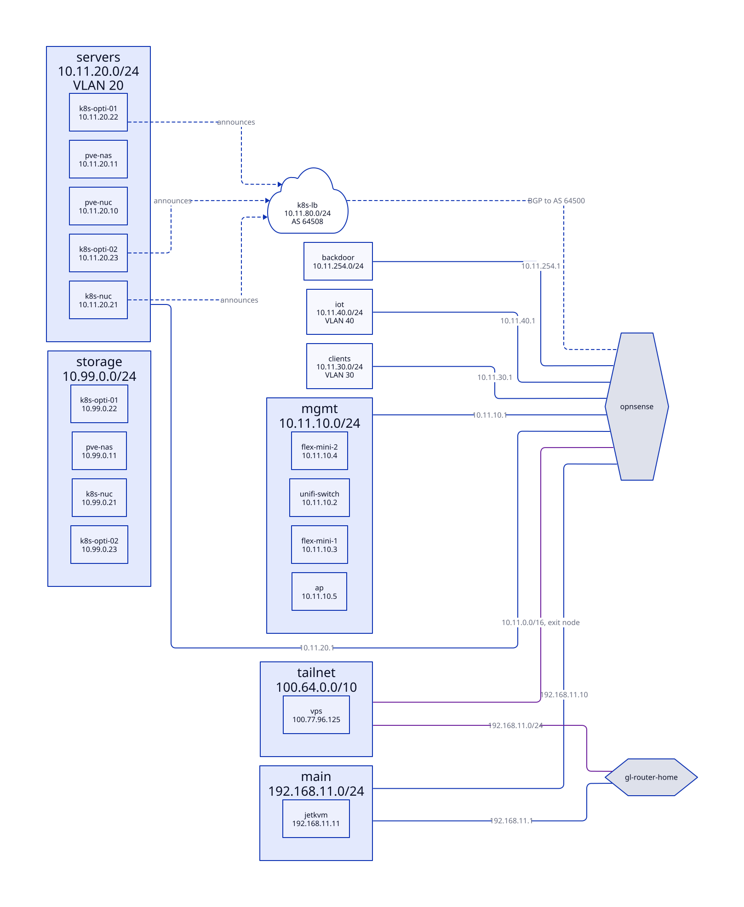

<!-- GENERATED by just docs; do not edit -->
# Network

> **Target state**: this page describes the home network after the OPNsense cut-over, which hasn't happened yet.

From [`ansible/group_vars/all/network.yaml`](../ansible/group_vars/all/network.yaml), with the Devices from [`devices.yaml`](../ansible/group_vars/all/devices.yaml). Each Device's Ports and Cables are in [devices.md](devices.md).

## Networks

| Network | CIDR | VLAN | Gateway | DHCP | For |
|---|---|---|---|---|---|
| main | 192.168.11.0/24 |  | gl-router-home |  | Upstream: gl-router-home, the OPNsense WAN and jetkvm, kept off the trunk |
| mgmt | 10.11.10.0/24 | 10 | opnsense | .100-.199 | Network gear only, the UniFi switch, Flex Minis and AP |
| servers | 10.11.20.0/24 | 20 | opnsense | .100-.199 | Every Host, including the Proxmox UI and the Talos API |
| clients | 10.11.30.0/24 | 30 | opnsense | .100-.199 | Personal devices, and SSID ST |
| iot | 10.11.40.0/24 | 40 | opnsense | .100-.199 | Media and smart devices, and SSID ST-IoT: internet plus specific allowances |
| break-glass | 10.11.254.0/24 |  | opnsense | .100-.199 | opnsense:3 only, for a laptop when the trunk is broken: OPNsense UI and SSH only |
| storage | 10.99.0.0/24 |  |  |  | NAS to Kubernetes at 2.5G on switch-2g5, unrouted |
| tailnet | 100.64.0.0/10 |  |  |  | The VPS and the other tailnet peers |

## Addresses

A MAC makes the address a DHCP reservation on OPNsense; the rest are static on the Device.

### main

| Name | Address | DNS | MAC |
|---|---|---|---|
| gl-router-home | 192.168.11.1 | gl-router-home.main.home.sbbh.cloud, gl-router-home.home.sbbh.cloud |  |
| opnsense | 192.168.11.10 | opnsense.main.home.sbbh.cloud |  |
| jetkvm | 192.168.11.11 | jetkvm.main.home.sbbh.cloud, jetkvm.home.sbbh.cloud |  |

### mgmt

| Name | Address | DNS | MAC |
|---|---|---|---|
| opnsense | 10.11.10.1 | opnsense.mgmt.home.sbbh.cloud |  |
| unifi-switch | 10.11.10.2 | unifi-switch.mgmt.home.sbbh.cloud, unifi-switch.home.sbbh.cloud | TODO(you) |
| flex-mini-1 | 10.11.10.3 | flex-mini-1.mgmt.home.sbbh.cloud, flex-mini-1.home.sbbh.cloud | TODO(you) |
| flex-mini-2 | 10.11.10.4 | flex-mini-2.mgmt.home.sbbh.cloud, flex-mini-2.home.sbbh.cloud | TODO(you) |
| ap | 10.11.10.5 | ap.mgmt.home.sbbh.cloud, ap.home.sbbh.cloud | TODO(you) |

### servers

| Name | Address | DNS | MAC |
|---|---|---|---|
| opnsense | 10.11.20.1 | opnsense.servers.home.sbbh.cloud |  |
| pve-nuc | 10.11.20.10 | pve-nuc.servers.home.sbbh.cloud, pve-nuc.home.sbbh.cloud |  |
| pve-nas | 10.11.20.11 | pve-nas.servers.home.sbbh.cloud, pve-nas.home.sbbh.cloud |  |
| k8s-nuc | 10.11.20.21 | k8s-nuc.servers.home.sbbh.cloud, k8s-nuc.home.sbbh.cloud |  |
| k8s-opti-01 | 10.11.20.22 | k8s-opti-01.servers.home.sbbh.cloud, k8s-opti-01.home.sbbh.cloud |  |
| k8s-opti-02 | 10.11.20.23 | k8s-opti-02.servers.home.sbbh.cloud, k8s-opti-02.home.sbbh.cloud |  |

### clients

| Name | Address | DNS | MAC |
|---|---|---|---|
| opnsense | 10.11.30.1 | opnsense.clients.home.sbbh.cloud |  |

### iot

| Name | Address | DNS | MAC |
|---|---|---|---|
| opnsense | 10.11.40.1 | opnsense.iot.home.sbbh.cloud |  |

### break-glass

| Name | Address | DNS | MAC |
|---|---|---|---|
| opnsense | 10.11.254.1 | opnsense.break-glass.home.sbbh.cloud |  |

### storage

| Name | Address | DNS | MAC |
|---|---|---|---|
| pve-nas | 10.99.0.11 |  |  |
| k8s-nuc | 10.99.0.21 |  |  |
| k8s-opti-01 | 10.99.0.22 |  |  |
| k8s-opti-02 | 10.99.0.23 |  |  |

### tailnet

| Name | Address | DNS | MAC |
|---|---|---|---|
| vps | 100.77.96.125 |  |  |

## Pools

| Pool | CIDR | ASN | Peer | Announced by |
|---|---|---|---|---|
| k8s-lb | 10.11.80.0/24 | 64508 | opnsense (AS 64500) | k8s-nuc, k8s-opti-01, k8s-opti-02 |

## SSIDs

Set by hand in the UniFi Network Application.

| SSID | Network |
|---|---|
| ST | clients |
| ST-IoT | iot |

## Tailnet routes

| Node | Routes | Exit node |
|---|---|---|
| opnsense | 10.11.0.0/16 | yes |
| gl-router-home | 192.168.11.0/24 |  |

## Switch and router Ports

The peer is the Port at the far end, traced through the patch panels. UniFi Port profiles are set by hand to match.

### opnsense

| Port | Speed | Native | Tagged | Peer |
|---|---|---|---|---|
| 0 | 2.5G | main |  | switch-3p:2 |
| 1 | 2.5G |  | mgmt, servers, clients, iot | unifi-switch:1 via patch-panel:3 |
| 2 | 2.5G |  |  |  |
| 3 | 2.5G | break-glass |  |  |
| hdmi |  |  |  | kvm-switch:1-hdmi |
| usb |  |  |  | kvm-switch:1-usb |

### switch-2g5

| Port | Speed | Native | Tagged | Peer |
|---|---|---|---|---|
| 1 | 2.5G |  |  | k8s-nuc:eth-2g5 via keystone:eth2, patch-panel:10 |
| 2 | 2.5G |  |  | k8s-opti-01:eth-2g5 via keystone:eth3, patch-panel:11 |
| 3 | 2.5G |  |  | k8s-opti-02:eth-2g5 via keystone:eth4, patch-panel:12 |
| 4 | 2.5G |  |  | pve-nas:1 |
| 5 | 2.5G |  |  |  |

### switch-3p

| Port | Speed | Native | Tagged | Peer |
|---|---|---|---|---|
| 1 | 1G |  |  | jetkvm:eth |
| 2 | 1G |  |  | opnsense:0 |
| 3 | 1G |  |  | gl-router-home:lan |

### unifi-switch

| Port | Speed | Native | Tagged | Peer |
|---|---|---|---|---|
| 1 | 1G |  | mgmt, servers, clients, iot | opnsense:1 via patch-panel:3 |
| 2 | 1G |  |  |  |
| 3 | 1G | mgmt | clients, iot | flex-mini-1:1 via patch-panel:4 |
| 4 | 1G |  |  |  |
| 5 | 1G | servers |  | k8s-nuc:eth-1g via patch-panel:5 |
| 6 | 1G |  |  |  |
| 7 | 1G | servers |  | k8s-opti-01:eth-1g via patch-panel:6 |
| 8 | 1G |  |  |  |
| 9 | 1G | servers |  | k8s-opti-02:eth-1g via patch-panel:7 |
| 10 | 1G |  |  |  |
| 11 | 1G | servers |  | pve-nuc:eth via patch-panel:8 |
| 12 | 1G |  |  |  |
| 13 | 1G | servers |  | pve-nas:0 via patch-panel:9 |
| 14 | 1G |  |  |  |
| 15 | 1G |  |  |  |
| 16 | 1G |  |  |  |

### gl-router-home

| Port | Speed | Native | Tagged | Peer |
|---|---|---|---|---|
| wan | 1G |  |  |  |
| lan | 1G | main |  | switch-3p:3 |

### flex-mini-1

| Port | Speed | Native | Tagged | Peer |
|---|---|---|---|---|
| 1 | 1G | mgmt | clients, iot | unifi-switch:3 via patch-panel:4 |
| 2 | 1G | mgmt | clients, iot | flex-mini-2:1 |
| 3 | 1G |  |  |  |
| 4 | 1G |  |  |  |
| 5 | 1G |  |  |  |

### flex-mini-2

| Port | Speed | Native | Tagged | Peer |
|---|---|---|---|---|
| 1 | 1G | mgmt | clients, iot | flex-mini-1:2 |
| 2 | 1G | mgmt | clients, iot | ap:eth |
| 3 | 1G |  |  |  |
| 4 | 1G |  |  |  |
| 5 | 1G |  |  |  |
