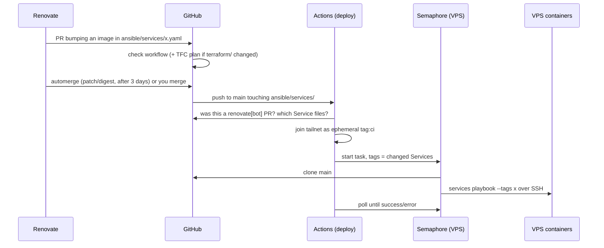

---
covers:
  - .github/workflows/deploy.yaml
  - terraform/tfe-admin/main.tf
---
# How it fits together

The moving parts, what triggers what, and which credential each part holds. The details live in the linked pages; this page is the map.

## Parts

| Part | Where | Does |
|---|---|---|
| Ansible services role | laptop or Semaphore | Deploys Services as Docker containers to Hosts over SSH ([runbooks/deploy.md](runbooks/deploy.md)) |
| Semaphore | a Service on the VPS | Runs the services playbook for Auto-deploys ([automation.md](automation.md#semaphore)) |
| Renovate | Mend-hosted GitHub App | Opens PRs for new versions, automerges the safe ones ([automation.md](automation.md#renovate)) |
| GitHub Actions | GitHub | `check` on every PR; `deploy` after a Renovate merge ([automation.md](automation.md)) |
| Terraform Cloud | org `sbbh-cloud` | Plans every PR, applies `cloudflare` and `tailscale` from `main` ([terraform.md](terraform.md)) |
| `tfe-admin` | laptop, state in TFC | Creates the TFC workspaces and copies secrets into them and into GitHub |
| Tailscale | tailnet | The only network path to any Service; the policy is the `tailscale` stack |
| Bitwarden Secrets Manager | Bitwarden | Every secret; filled from the vault through `.bws.yaml` ([architecture.md](architecture.md#secrets)) |

## A Version Bump, end to end

The workflow mirrors the task's result, so a failed Deploy shows as a failed workflow run (and GitHub's failure email). The output stays in Semaphore.

## Other changes

| Change | What happens | What you do |
|---|---|---|
| Hand edit to a Service, the role, group_vars or the inventory | `check` runs on the PR; the deploy workflow skips it | Deploy by hand: `just ansible::playbook services --tags <service>` |
| Minor or major image bump | Renovate opens a PR and waits | Review, merge; it then Auto-deploys like any Version Bump |
| Semaphore bump | Never automerges | Merge, then `--tags semaphore` by hand |
| mise tool (minor/patch) | Renovate commits straight to `main` | Nothing; `mise install` picks it up |
| `terraform/cloudflare` | TFC plans the PR, applies on merge | Nothing |
| `terraform/tailscale` | TFC plans the PR, waits after merge | Confirm the run in the TFC UI |
| Workspace settings or their secrets (`terraform/tfe-admin`) | Nothing runs on its own | `just tf::apply tfe-admin` |
| New secret | Nothing until something reads it | Vault item → `.bws.yaml` → sync; then Deploy, or `just tf::apply tfe-admin` for Terraform/GitHub secrets |

## Credentials

Who holds what, and where it comes from. Everything marked Bitwarden is a Secrets Manager key, filled from `.bws.yaml`.

| Credential | Comes from | Held by | Lets it |
|---|---|---|---|
| `BWS_ACCESS_TOKEN` (laptop machine account) | `.env` | laptop: Ansible, `just tf::` | Read every secret |
| `SEMAPHORE_BWS_ACCESS_TOKEN` (`semaphore` machine account) | Bitwarden → Semaphore container env | Semaphore tasks | Read the Service secrets |
| `SEMAPHORE_ACCESS_KEY_ENCRYPTION` | Bitwarden → Semaphore container env | Semaphore | Encrypt its Key Store; never rotate it casually |
| Semaphore SSH key | Semaphore Key Store; public half in `root`'s `authorized_keys` on the VPS | Semaphore tasks | SSH to the VPS as root |
| `SEMAPHORE_API_TOKEN` | Bitwarden → GitHub secret, by `tfe-admin` | deploy workflow | Start and poll Semaphore tasks |
| `TS_OAUTH_CLIENT_ID` / `TS_OAUTH_SECRET` (`tag:ci`) | created by the `tailscale` stack → GitHub secrets, by `tfe-admin` | deploy workflow | Join the tailnet; reach only `vps:443` |
| `TAILSCALE_TERRAFORM_OAUTH_CLIENT_ID` / `_SECRET` | Bitwarden → `tailscale` workspace env, by `tfe-admin` | `tailscale` stack | Write the policy, create the CI client |
| `CLOUDFLARE_API_TOKEN` | Bitwarden → `cloudflare` workspace env, by `tfe-admin`; also read by traefik | `cloudflare` stack, traefik | Edit DNS; DNS-01 for the wildcard cert |
| `TFC_API_TOKEN` (user token) | Bitwarden | `just tf::init` / `just tf::apply` | Reach TFC state and manage workspaces |
| GitHub token | `gh auth token` on the laptop | `tfe-admin` | Write GitHub Actions secrets |
| HCP Terraform GitHub App | installed on `subbeh`, plus your user's GitHub App OAuth token | TFC | Run VCS workspaces, post plan checks |
| Mend Renovate GitHub App | installed on `subbeh` | Renovate | Open and merge PRs |

The one-time steps that create these are in [runbooks/manual-setup.md](runbooks/manual-setup.md).
